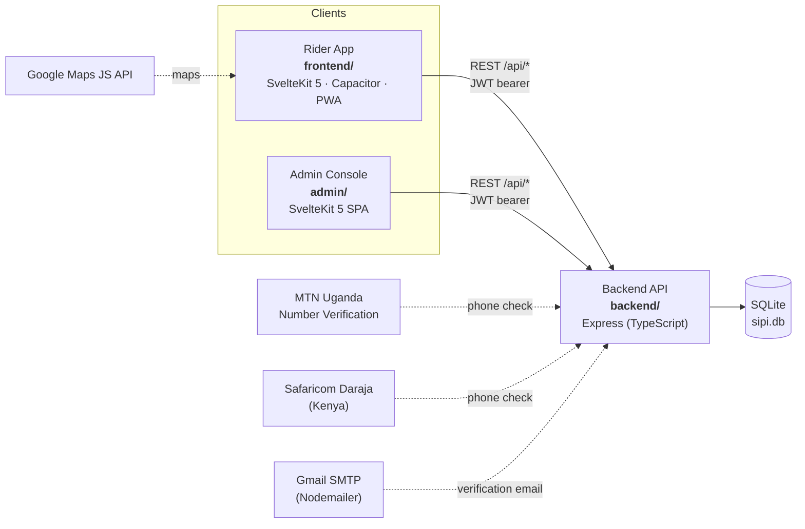
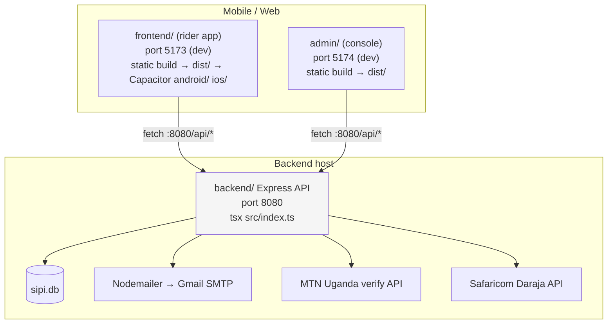
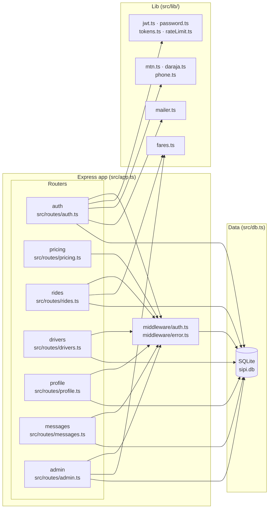
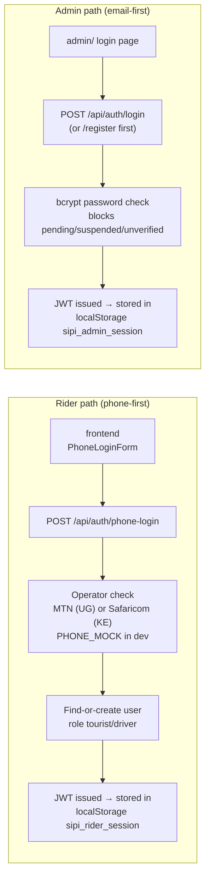
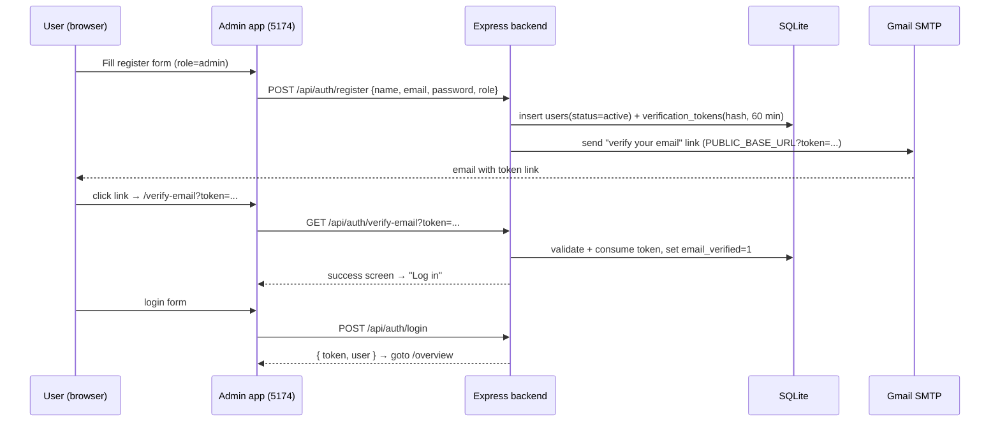
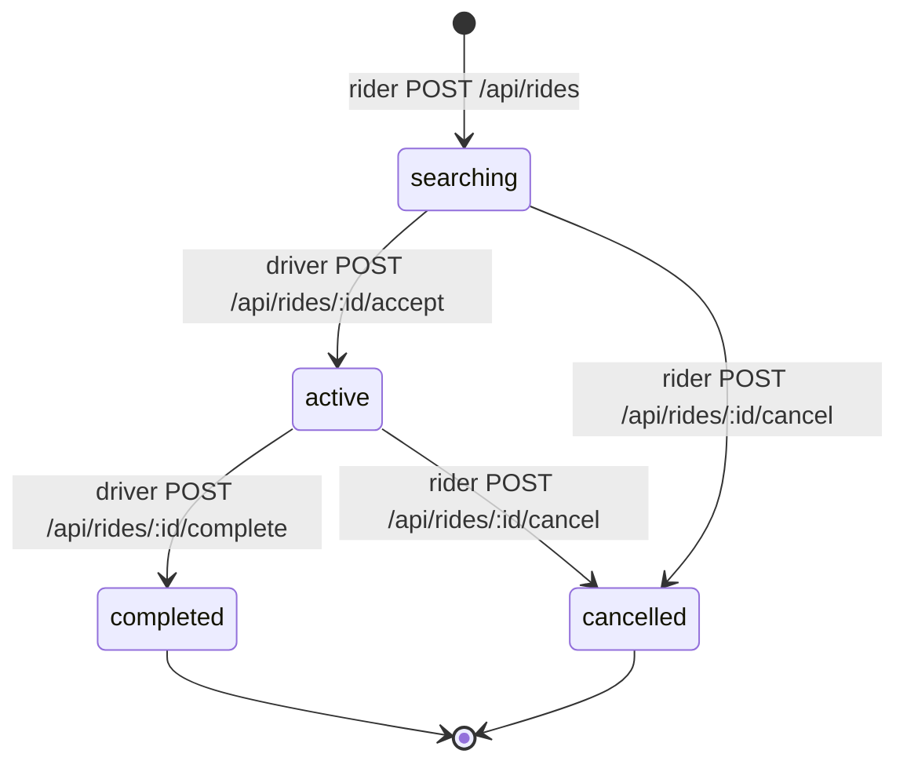
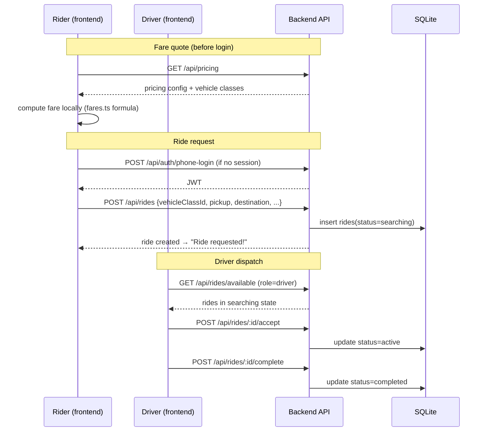
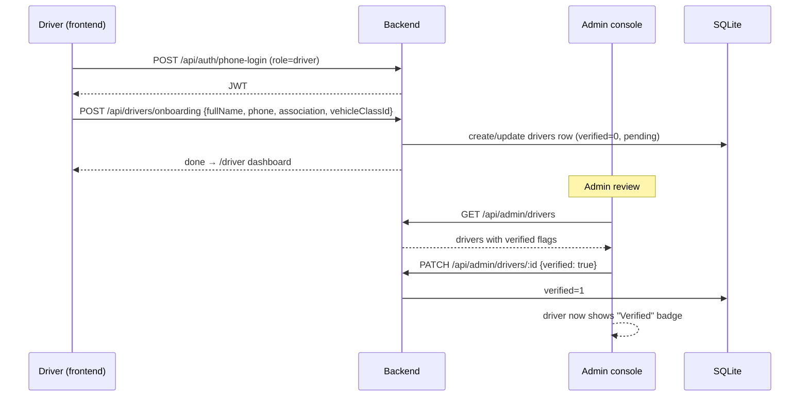
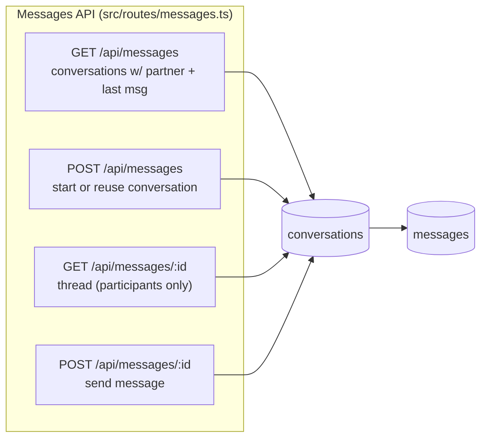
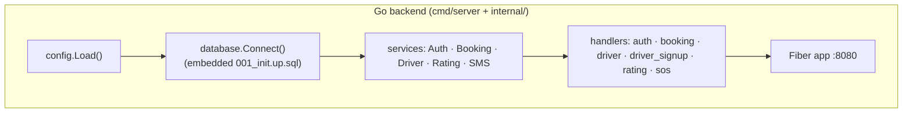

# Sipi Rider — Architecture

This document describes how the Sipi Rider platform is structured and how data flows through it. It is a **line-by-line review** of the codebase in this repository, written to match what the code actually does today.

Related docs:

- [frontend.md](frontend.md) — the rider mobile/web app
- [admin.md](admin.md) — the admin console
- [backend.md](backend.md) — the backend API, data model, and integrations

---

## 1. System context

Sipi Rider connects three kinds of users:

- **Tourists / riders** — book a ride from the mobile app, chat with their driver, and view their ride history.
- **Drivers** — apply via the app, go online/offline, get assigned rides, and are verified by admins.
- **Admins** — manage pricing, verify drivers, and approve/suspend user accounts from the admin console.



Notes from the code review:

- Both web clients are **pure client-side SPAs** (`adapter-static` with `fallback: index.html`). There are no server-side load functions, hooks, or `+server.ts` routes anywhere — all data fetching happens in the browser.
- Both clients share the **same HTTP client pattern** (`$lib/http.ts`) and default `API_BASE` of `http://localhost:8080`.
- The **Express backend is the API both frontends are wired to**. Its endpoint contract matches the API client functions in `frontend/src/lib/api.ts` and `admin/src/lib/api.ts` exactly.
- A **second, older backend** also lives in `backend/` — a Go/Fiber port of a previous prototype. It is *not* what the frontends talk to and has an incompatible schema. See [backend.md](backend.md) §8.

---

## 2. Containers & deployment topology



Key environment variables (`backend/.env.example`):

| Variable | Default | Purpose |
|---|---|---|
| `PORT` | `8080` | HTTP listen port |
| `DB_PATH` | `./sipi.db` | SQLite file |
| `JWT_SECRET` | dev default | HS256 signing secret |
| `PUBLIC_BASE_URL` | `http://localhost:5174` | Base URL for email verification links (admin app) |
| `VERIFY_TOKEN_TTL_MIN` | `60` | Verification token TTL |
| `SMTP_*` / `MAIL_FROM` | — | Gmail SMTP relay |
| `MTN_*` | — | MTN Uganda number verification |
| `DARAJA_*` | — | Safaricom (Kenya) number verification |
| `PHONE_MOCK` | `true` | Bypass operator verification in dev (must be `false` in prod) |

Client env vars:

| App | Variable | Default |
|---|---|---|
| frontend | `VITE_API_BASE_URL` | `http://localhost:8080` |
| frontend | `VITE_GOOGLE_MAPS_API_KEY` | (set in `.env`) |
| admin | `VITE_API_BASE_URL` | `http://localhost:8080` |

---

## 3. Component diagram (backend)

The Express backend is organized in the classic MVC style: routes → middleware → lib helpers → SQLite.



---

## 4. Identity & authentication

There are **two separate login paths** — one for riders (phone-first), one for admins (email-first). Both issue the same kind of HS256 JWT, validated by `backend/src/middleware/auth.ts` (`requireAuth`) and role-checked by `requireRole('admin' | 'driver')`.



**Registration + email verification (admin path):**



**Phone verification (rider path):**

```mermaid
sequenceDiagram
    participant U as Rider (app)
    participant App as frontend (5173)
    participant API as Express backend
    participant OP as MTN / Daraja API
    participant DB as SQLite

    U->>App: enter +256 / +254 number
    App->>API: POST /api/auth/phone-login {phone, role}
    API->>API: rate limit (10/hr per phone)
    API->>OP: verify operator number (skipped if PHONE_MOCK)
    OP-->>API: verified
    API->>DB: find user by phone; create (role=tourist/driver) if new
    API-->>App: { token, user } → saved to localStorage
```

---

## 5. Ride lifecycle

The core business flow — a **ride** goes from `searching` → `active` → `completed` (or `cancelled`). Rider books, drivers see available rides and accept, the assigned driver completes it.





**Fare formula** (`backend/src/lib/fares.ts`):

```
fare = (base_fare + per_km × distance_km + per_minute × duration_min)
       × vehicle_class.multiplier
       × booking_fee
       × surge_multiplier
fare = max(fare, minimum_fare)
```

---

## 6. Driver onboarding & verification



---

## 7. Messaging

Conversations are pairwise (`user_a`, `user_b`) and created on demand. This is a simple REST message inbox — there is **no websocket/push layer** in the codebase.



---

## 8. Admin operations

The admin console is the source of truth for **pricing**, **driver verification**, and **user moderation**.

| Concern | Read | Write |
|---|---|---|
| Pricing | `GET /api/admin/pricing` | `PUT /api/admin/pricing` |
| Driver verification | `GET /api/admin/drivers` | `PATCH /api/admin/drivers/:id` |
| User moderation | `GET /api/admin/users` | `PATCH /api/admin/users/:id` |

Admin flows, route-by-route, are documented in [admin.md](admin.md). Public pricing reads mirror these via `GET /api/pricing` and `GET /api/vehicle-classes`.

---

## 9. The Go/Fiber prototype (secondary backend)

`backend/cmd/` and `backend/internal/` contain a **Go port of a previous prototype** that predates the Express backend. Review findings:

- Framework: **Fiber v2**, JWT (`golang-jwt`), SQLite (`mattn/go-sqlite3`, CGO), UUIDs.
- Identity: **phone + OTP** with roles `citizen` / `driver` (no email/password, no admin).
- Domain: **bookings** (`pending → confirmed → declined → completed`), SOS alerts, ratings, and shareable trip links (`GET /api/trips/share/:token`).
- SMS: console-only stub (`services/sms.go` logs instead of sending).
- Routes are wired in `cmd/server/main.go` and mirror the Express feature set (drivers, bookings, auth) under a different contract.



> **Important operational warning:** both backends default to port `8080` and `DB_PATH=./sipi.db`, but the Go schema (`users` keyed by `phone`, `bookings`, `otp_codes`) is **incompatible** with the Express schema (`users` keyed by `id` with `password_hash`, `rides`, `pricing`, `messages`). The on-disk `sipi.db` currently holds the Express/legacy shape. **Run only one backend against a database at a time** — see [backend.md](backend.md) §8 for the full comparison.

---

## 10. Cross-cutting concerns

- **State management:** each client keeps exactly one Svelte store — `session` (a JWT + user object) in `frontend/src/lib/auth.ts` and `admin/src/lib/auth.ts`. Persisted to `localStorage`.
- **HTTP client:** a thin `fetch` wrapper (`http<T>()`) in both apps that injects `Authorization: Bearer` and normalizes errors into `ApiError { status, code, message }`.
- **Rate limiting:** in-memory, fixed-window (`src/lib/rateLimit.ts`) — applied to `phone-login` (10/hr/phone) and `resend-verification` (3/hr). Not shared across processes; resets on restart.
- **Caching:** token caches for MTN/Daraja OAuth bearer tokens (in-memory, refreshed before expiry). No Redis, no job queue, no websockets.
- **PWA / offline:** the rider app registers a Workbox service worker (generateSW) and caches Google Maps scripts/tiles with a NetworkFirst strategy.
- **Security notes from review:**
  - The Go JWT parser does not enforce the `alg` on verification.
  - `.env` (gitignored) contains what look like live MTN/Daraja credentials — rotate if genuine.
  - `PHONE_MOCK=true` must be disabled in production.

---

## 11. Directory map

```
My_rider/
├── README.md
├── docs/
│   ├── ARCHITECTURE.md   ← this file
│   ├── frontend.md
│   ├── admin.md
│   └── backend.md
├── frontend/
│   ├── capacitor.config.ts      # Capacitor 8 (android/ ios/)
│   ├── svelte.config.js         # adapter-static, SPA fallback
│   ├── vite.config.ts           # Tailwind v4 + VitePWA + port 5173
│   ├── tailwind.config.js       # legacy v3 tokens (app.css @theme is authoritative)
│   └── src/
│       ├── app.css              # Tailwind v4 @theme + custom utilities
│       ├── lib/                 # api.ts, auth.ts, http.ts, components/
│       └── routes/              # +page.svelte SPA screens (no server files)
├── admin/
│   ├── svelte.config.js         # adapter-static, SPA fallback
│   ├── vite.config.ts           # Tailwind v4 + port 5174
│   └── src/
│       ├── app.css
│       ├── lib/                 # api.ts, auth.ts, http.ts, types.ts
│       └── routes/
│           ├── (auth)/login     # login + register + verify
│           ├── (auth)/verify-email
│           └── (app)/           # overview, pricing, drivers, users
└── backend/
    ├── go.mod / cmd/ / internal/   # Go/Fiber prototype (f01578a, "previous prototype")
    ├── src/                        # Express/TypeScript backend (active)
    │   ├── app.ts                  # Express wiring + /api/health
    │   ├── config.ts               # env config
    │   ├── db.ts                   # schema + migration + seed
    │   ├── lib/                    # jwt, password, tokens, mailer, mtn, daraja, phone, fares, rateLimit
    │   ├── middleware/             # auth (JWT), error
    │   └── routes/                 # auth, pricing, rides, drivers, profile, messages, admin
    ├── .env.example
    └── sipi.db                     # SQLite (gitignored)
```
