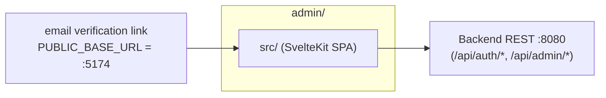
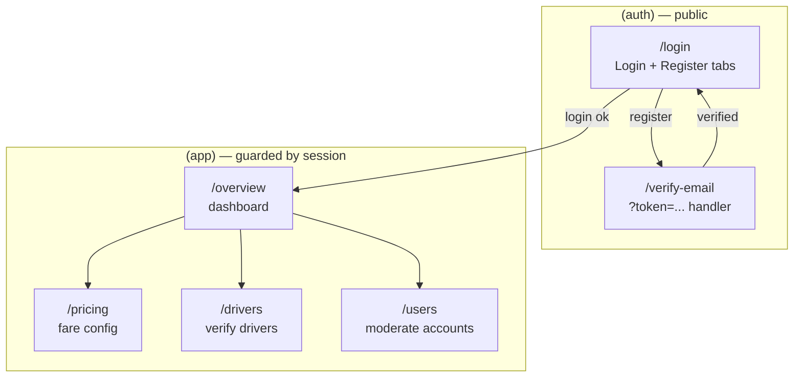
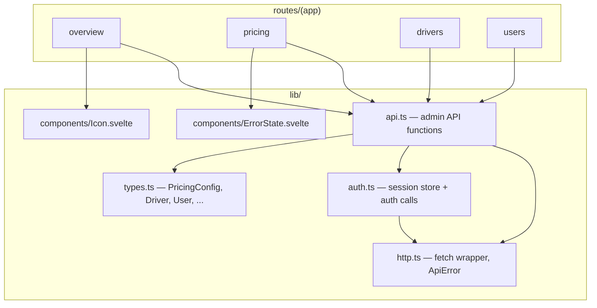
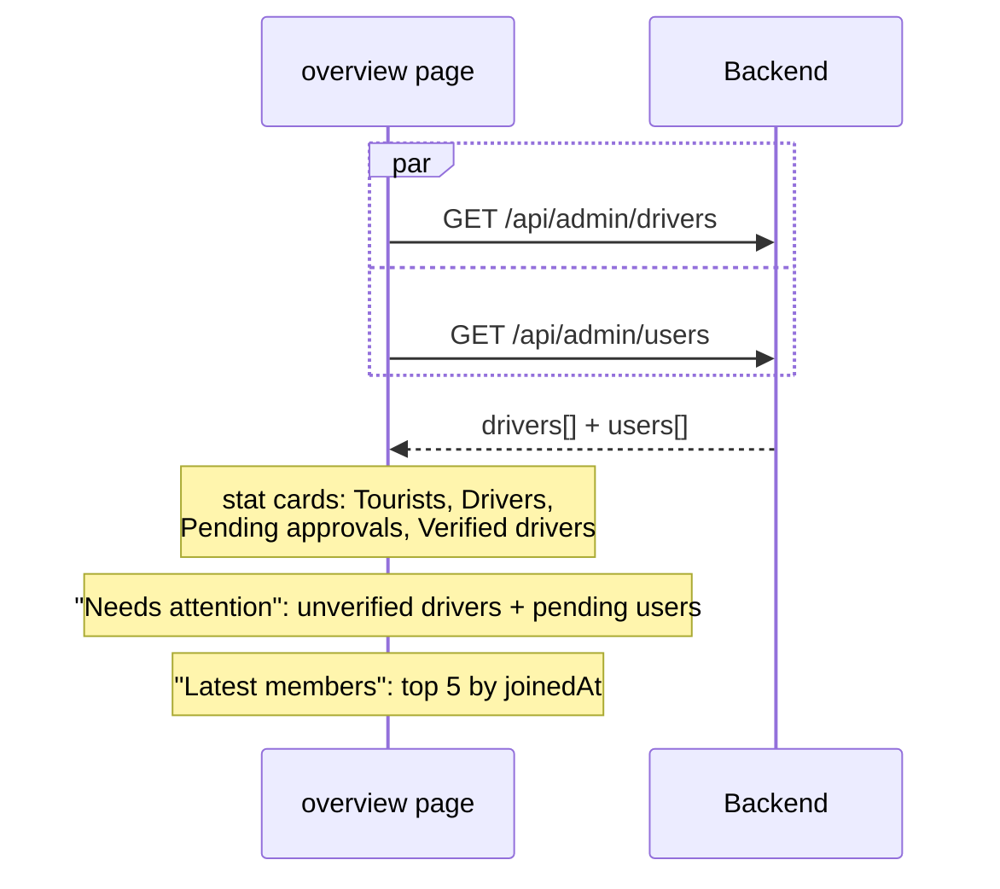
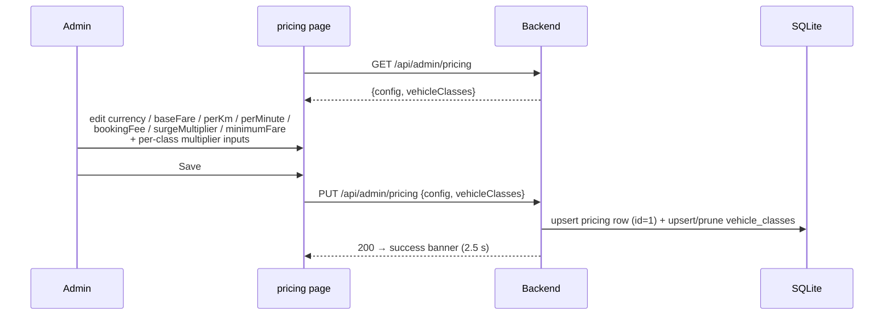
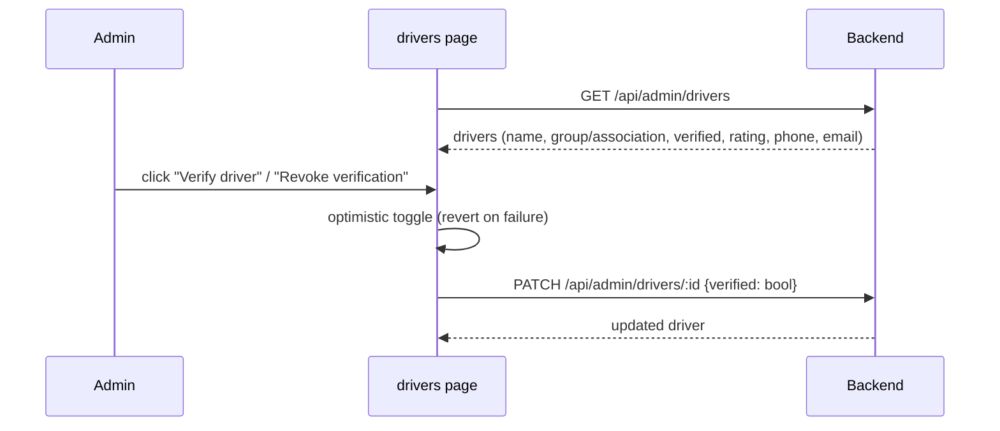
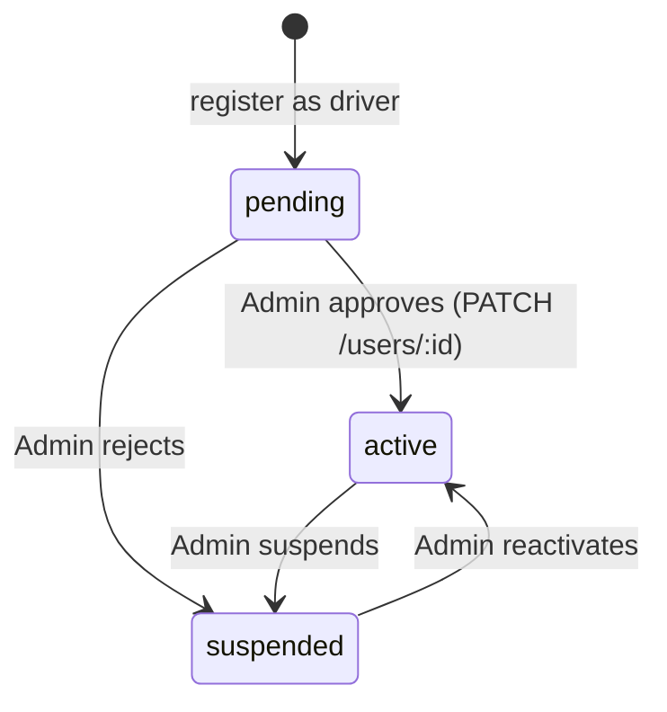
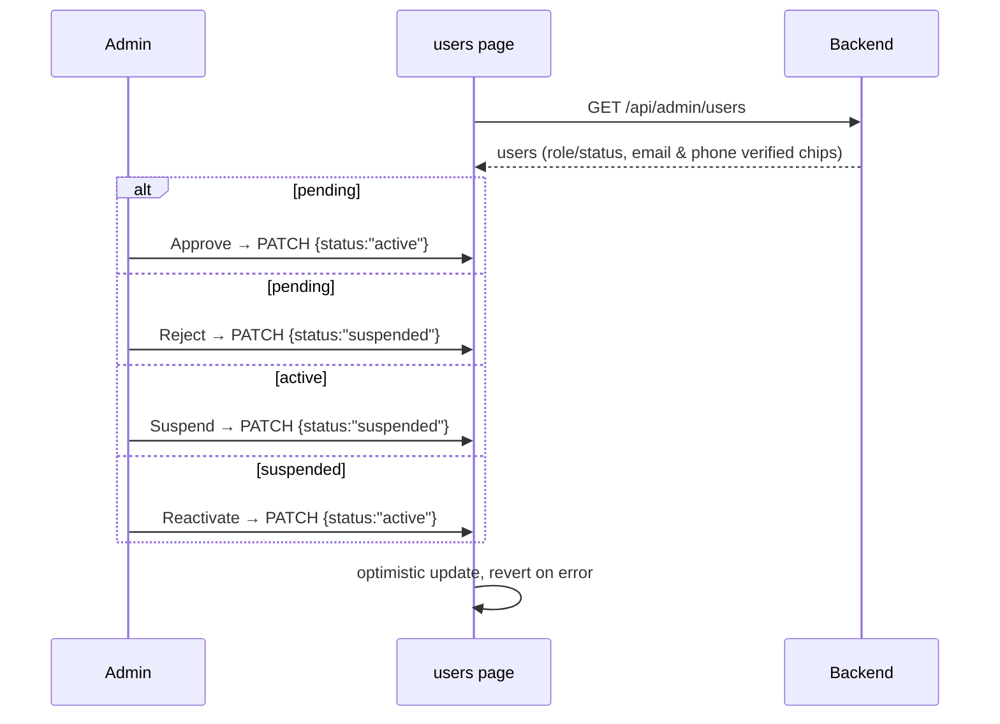

# Admin Console — Sipi Rider

The operations dashboard for Sipi Rider admins. Package name `sipirider-admin`, in `admin/`.

- **Framework:** SvelteKit 5 (runes) + Tailwind CSS v4, built as a **static SPA** (`adapter-static`, `fallback: index.html`)
- **Auth:** email + password against the backend; session persisted in `localStorage['sipi_admin_session']`
- **Dev port:** `5174` — this is also the backend's default `PUBLIC_BASE_URL` for verification-email links
- **API base:** `VITE_API_BASE_URL` (default `http://localhost:8080`)
- **Runtime deps:** none (everything is devDependencies) — pure client-side app



---

## 1. Screen map



| Route | File | Purpose |
|---|---|---|
| `/login` | `src/routes/(auth)/login/+page.svelte` | Login / register (role `admin`), email-verified gate |
| `/verify-email` | `src/routes/(auth)/verify-email/+page.svelte` | Consumes `?token=`, shows success/failure |
| `/overview` | `src/routes/(app)/overview/+page.svelte` | Dashboard — stats + "needs attention" + latest members |
| `/pricing` | `src/routes/(app)/pricing/+page.svelte` | Edit fare config + vehicle-class multipliers |
| `/drivers` | `src/routes/(app)/drivers/+page.svelte` | Driver list + verify/revoke |
| `/users` | `src/routes/(app)/users/+page.svelte` | User list + approve/reject/suspend/reactivate |

The `(app)/+layout.svelte` is the **auth guard + shell**: it `redirect(307, '/login')` when no token, re-validates the session via `restoreSession()` on mount, and renders a sidebar + header + mobile nav around the content.

---

## 2. Client architecture



### API surface (`src/lib/api.ts`)

| Function | Call | Purpose |
|---|---|---|
| `getPricing()` | `GET /api/admin/pricing` | pricing config + vehicle classes |
| `savePricing(config, vehicleClasses)` | `PUT /api/admin/pricing` | persist fare config + multipliers |
| `getDrivers()` | `GET /api/admin/drivers` | driver list |
| `verifyDriver(id, verified)` | `PATCH /api/admin/drivers/:id` | set `verified` |
| `getUsers()` | `GET /api/admin/users` | user list |
| `updateUserStatus(id, status)` | `PATCH /api/admin/users/:id` | `active`/`pending`/`suspended` |

### Auth (`src/lib/auth.ts`)

- `session = writable<Session|null>(readSession())`; localStorage key `sipi_admin_session`.
- `login(email,password)` → `POST /api/auth/login`; `register(name,email,password)` → `POST /api/auth/register` with `role:'admin'`.
- `verifyEmail(token)` → `GET /api/auth/verify-email?token=`.
- `resendVerification(email)` → `POST /api/auth/resend-verification`.
- `restoreSession()` → `GET /api/auth/me` (called on mount in the `(app)` layout; clears the session on failure).
- `isAuthenticated()` / `logout()`.

---

## 3. Login & registration flow

```mermaid
sequenceDiagram
    participant U as Admin
    participant L as login page
    participant A as Backend
    participant DB as SQLite

    alt Register (first time)
        U->>L: "Create account" tab → name/email/password
        L->>A: POST /api/auth/register {role:"admin"}
        A->>DB: users(status=active) + verification_tokens
        A->>A: send verification email (SMTP or DEV outbox)
        A-->>L: "Check your email" card
        U->>L: click emailed link → /verify-email?token=
        L->>A: GET /api/auth/verify-email?token=
        A->>DB: email_verified=1
        A-->>L: success → "Log in"
    end

    U->>L: email + password
    L->>A: POST /api/auth/login
    A->>DB: verify bcrypt + status + email_verified
    alt suspended / pending / unverified
        A-->>L: ApiError (code shown; unverified offers "Resend verification")
    else ok
        A-->>L: {token, user}
        L->>L: persist session → goto /overview
    end
```

Note: admin registrations start `status=active`, so after email verification they can log in immediately (unlike drivers, who start `pending`).

---

## 4. Overview dashboard

`/overview` loads drivers + users in parallel:



---

## 5. Pricing management

`/pricing` edits the single `pricing` row plus vehicle-class multipliers, then saves both together:



The UI shows the fare formula banner: `(base + per-km × km + per-min × min) × vehicle class surge × booking fee`. These values feed the same formula the rider app uses on `/get-started` and `backend/src/lib/fares.ts`.

---

## 6. Driver verification



This is what flips a driver from `verified=false` (onboarding) to `verified=true`, surfacing as the "Verified" badge in the rider app's driver dashboard.

---

## 7. User moderation





---

## 8. Styling

- **Tailwind v4** via `@tailwindcss/vite` — no `tailwind.config.js`. Tokens in `src/app.css` `@theme`: primary/deep/light teal, `--color-bg`, success, text colors, border, font scale, Inter.
- Custom utilities (`@utility`): `field-label`, `field-input`, `btn-primary`, `btn-secondary`, `card`, `chip`, `chip-active`.
- Components: `Icon` (inline SVG set incl. dashboard/logout/edit/trash/settings), `ErrorState` (reusable error card with retry).

---

## 9. Environment & config

| File | Notes |
|---|---|
| `vite.config.ts` | Tailwind v4 + SvelteKit; dev port `5174` |
| `svelte.config.js` | `adapter-static` → `dist/`, `fallback: index.html` (SPA) |
| `.npmrc` | `engine-strict=true` |
| `tsconfig.json` | strict, bundler resolution, `rewriteRelativeImportExtensions` |

**Env vars:** only `VITE_API_BASE_URL` (default `http://localhost:8080`). No `.env`/`.env.example` present.

### Notes from the review

- Auth is enforced **client-side only** (redirect in the layout); there is no server-side protection because the app is a static SPA. The real enforcement is the backend's `requireAuth` + `requireRole('admin')`.
- No automatic 401 handling in `http.ts` — a stale session is caught by `restoreSession()` in the layout and bounced to `/login`.
- `backend/src/routes/admin.ts` implements exactly the endpoints this app calls, with `admin` role guard — the two sides are in sync.
