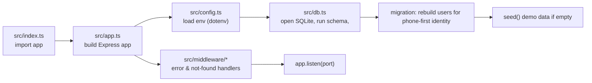
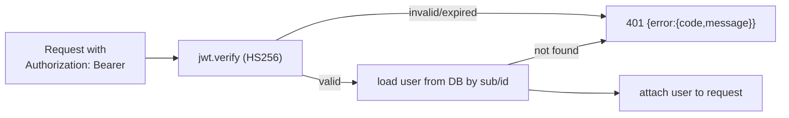
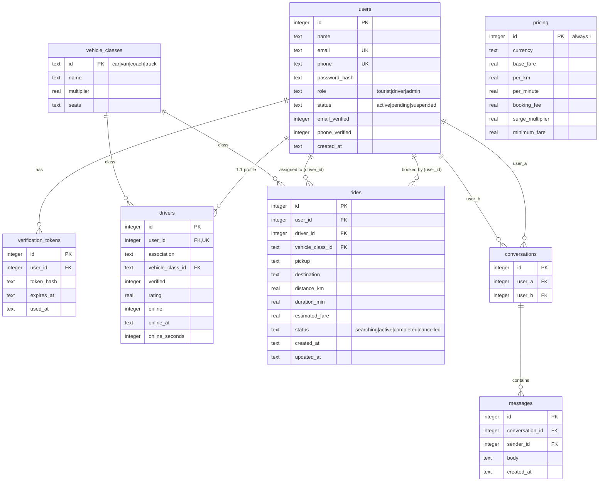
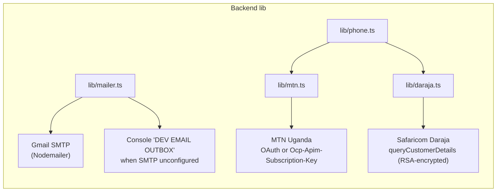
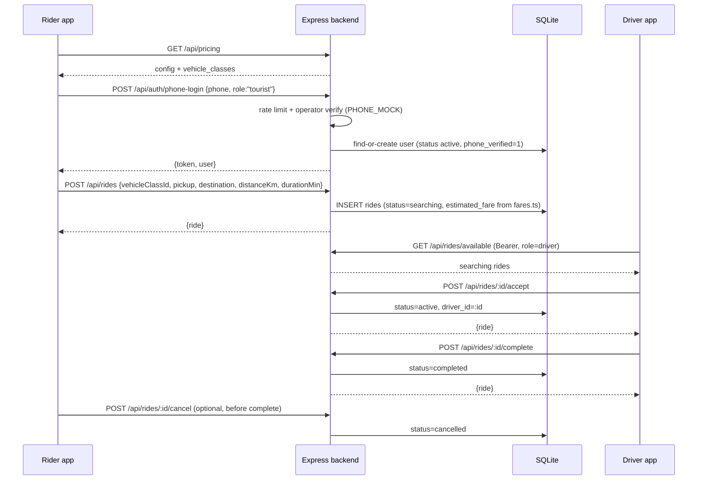
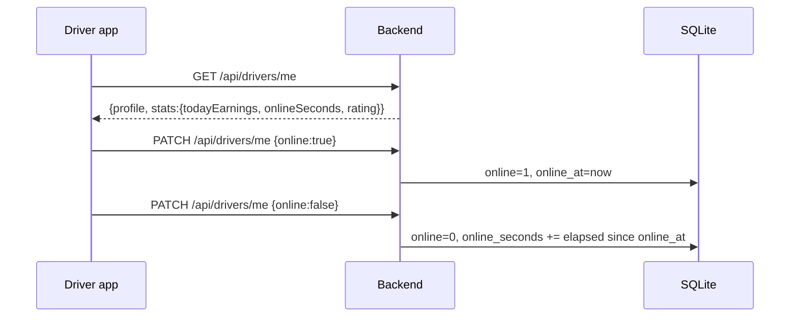
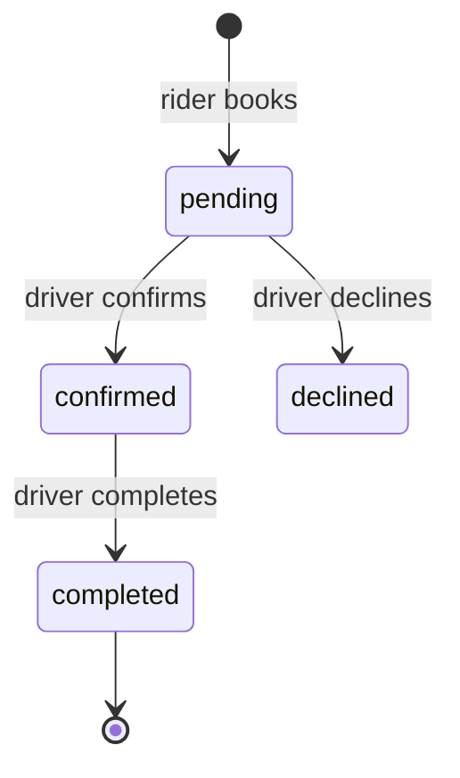

# Backend — Sipi Rider API

This document details the backend of Sipi Rider — the **TypeScript/Express API**, the single backend that both frontends talk to. (A Go/Fiber prototype previously coexisted here and was removed; see §8 for the historical comparison.)

- Source: `backend/`
- Runtime: `npm run dev` → `tsx watch src/index.ts` (or `npm start`), listens on `:8080` by default
- Data store: SQLite via `better-sqlite3` (`sipi.db`)
- See also: [ARCHITECTURE.md](ARCHITECTURE.md), [frontend.md](frontend.md), [admin.md](admin.md)

---

## 1. Boot sequence



1. `src/index.ts` imports `app` from `src/app.ts` and the `config`/`db` modules (importing `db` has the side effect of creating & seeding the database), then calls `app.listen(config.port)`.
2. `src/app.ts` wires global CORS, JSON body parsing, `GET /api/health`, and mounts all routers, then the `notFoundHandler` and `errorHandler`.
3. `src/db.ts` opens `sipi.db` (creating the directory if needed), enables `foreign_keys`, executes `CREATE TABLE IF NOT EXISTS` DDL, runs a one-time migration that rebuilds `users` if a legacy `email NOT NULL` column is present (so phone-only accounts work), and seeds demo data when the `users` table is empty.

---

## 2. Project layout

```
backend/src/
├── index.ts            # entry point
├── app.ts              # Express wiring + /api/health
├── config.ts           # typed env config
├── db.ts               # schema + migration + seed
├── errors.ts           # ApiError + error helpers
├── types.ts            # shared TS types
├── lib/
│   ├── jwt.ts          # sign/verify HS256 JWT
│   ├── password.ts     # bcrypt hash/compare
│   ├── tokens.ts       # verification tokens (hash + TTL)
│   ├── mailer.ts       # Nodemailer / Gmail SMTP (console fallback)
│   ├── mtn.ts          # MTN Uganda number verification
│   ├── daraja.ts       # Safaricom Daraja number verification
│   ├── phone.ts        # phone normalization + operator detection (UG/KE)
│   ├── fares.ts        # fare calculation
│   └── rateLimit.ts    # in-memory fixed-window limiter
├── middleware/
│   ├── auth.ts         # requireAuth / requireRole
│   └── error.ts        # notFoundHandler / errorHandler
└── routes/
    ├── auth.ts
    ├── pricing.ts
    ├── rides.ts
    ├── drivers.ts
    ├── profile.ts
    ├── messages.ts
    └── admin.ts
```

---

## 3. Middleware & auth

`src/middleware/auth.ts`:



- `requireAuth` — verifies the bearer token and loads the user from the DB on every request; rejects with 401 otherwise.
- `requireRole(...roles)` — after `requireAuth`, checks `user.role` is one of the allowed roles (e.g. `admin`, `driver`).

`src/lib/jwt.ts` — signs HS256 tokens with `config.jwtSecret`; the token `sub` is the user id. Both frontends store the token in `localStorage`.

---

## 4. Data model

Entities in `src/db.ts`. All timestamps default to `datetime('now')` (UTC).



### Seed data (`seed()` in `src/db.ts`)

When `users` is empty the backend seeds:

- **8 users** — 1 admin (`admin@sipirider.com` / `admin1234`), 2 active tourists + 1 pending tourist (`tourist@sipirider.com` / `tourist1234`), and 4 drivers (`driver@sipirider.com` / `driver1234`). All start `phone_verified=1`.
- **4 vehicle classes** — `car` (×1.0, 4 seats), `van` (×1.25, 9–14), `coach` (×1.6, 15+), `truck` (×1.8, heavy load).
- **1 pricing row** — `USD`, base 3, per_km 1.2, per_minute 0.15, booking_fee 1, surge 1, min 5.
- **4 driver profiles** — two verified (Peter — Mbale Highway Drivers Group/van, Joseph — Kampala Tourist Taxis Assoc./car), two unverified (Grace — Entebbe Airport Drivers Union/coach, Sarah — unassigned/car).
- **2 rides** — one completed (Sheraton → Entebbe, 41 km, $58.17) and one `searching`.
- **1 conversation + 2 messages** between Amara (tourist) and Peter (driver).

---

## 5. HTTP API reference

Base URL: `http://localhost:8080` (override with `VITE_API_BASE_URL` in clients). All JSON. Errors return `{ error: { code, message } }`.

### Health & auth (`/api`)

| Method | Path | Auth | Description |
|---|---|---|---|
| GET | `/api/health` | — | Liveness probe `{status:"ok"}` |
| POST | `/api/auth/register` | — | Create account `{name,email,phone?,password(≥8),role}`; sends verification email; drivers start `pending` |
| POST | `/api/auth/login` | — | Email + password; 401 if suspended / pending / unverified |
| POST | `/api/auth/phone-login` | — | `{phone, role?}`; operator-verified, find-or-create (rate-limited 10/hr/phone) |
| GET | `/api/auth/verify-email?token=` | — | Consume token, set `email_verified` |
| POST | `/api/auth/resend-verification` | — | `{email}` (rate-limited 3/hr) |
| GET | `/api/auth/me` | Bearer | Current user |

### Public pricing (`/api`)

| Method | Path | Auth | Description |
|---|---|---|---|
| GET | `/api/pricing` | — | `{config, vehicleClasses}` |
| GET | `/api/vehicle-classes` | — | List of vehicle classes |

### Rides (`/api/rides`)

| Method | Path | Auth | Description |
|---|---|---|---|
| POST | `/api/rides/estimate` | — | `{vehicleClassId,distanceKm,durationMin}` → `{estimatedFare,currency}` |
| POST | `/api/rides` | tourist | Create ride (status `searching`) |
| GET | `/api/rides` | user | Rides where user is rider or driver |
| GET | `/api/rides/available` | driver | `searching` rides for dispatch |
| GET | `/api/rides/:id` | rider/driver/admin | Ride detail |
| POST | `/api/rides/:id/cancel` | rider | Cancel `searching`/`active` |
| POST | `/api/rides/:id/accept` | driver | Claim `searching` → `active` |
| POST | `/api/rides/:id/complete` | driver | Assigned driver: `active` → `completed` |

### Drivers (`/api/drivers`)

| Method | Path | Auth | Description |
|---|---|---|---|
| GET | `/api/drivers/me` | driver | Profile + stats (today earnings, onlineSeconds, rating) |
| PATCH | `/api/drivers/me` | driver | `{online}` toggle (tracks `online_at`/`online_seconds`), `association`, `vehicleClassId` |
| POST | `/api/drivers/onboarding` | driver | Create/update driver profile (`verified=0`) |

### Profile (`/api/profile`)

| Method | Path | Auth | Description |
|---|---|---|---|
| GET | `/api/profile` | user | Profile + nested driver object |
| PATCH | `/api/profile` | user | Update `name`, `phone` |

### Messages (`/api/messages`)

| Method | Path | Auth | Description |
|---|---|---|---|
| GET | `/api/messages` | user | Conversations with partner + last message |
| GET | `/api/messages/:id` | participant | Message thread |
| POST | `/api/messages/:id` | participant | Send message to existing conversation |
| POST | `/api/messages` | user | Start conversation `{recipientId, body}` or reuse existing |

### Admin (`/api/admin`) — all `requireAuth` + `requireRole('admin')`

| Method | Path | Description |
|---|---|---|
| GET | `/api/admin/pricing` | Pricing config + classes |
| PUT | `/api/admin/pricing` | Update pricing row + upsert/prune classes (protected when in use) |
| GET | `/api/admin/drivers` | Drivers joined with user info |
| PATCH | `/api/admin/drivers/:id` | `{verified: bool}` |
| GET | `/api/admin/users` | All users with verification flags |
| PATCH | `/api/admin/users/:id` | `{status: active|pending|suspended}` |

---

## 6. External integrations



- **Email (Gmail SMTP):** `mailer.ts` sends verification emails via Nodemailer using `SMTP_HOST/PORT/USER/PASS` + `MAIL_FROM`. When SMTP is unconfigured it logs to a `DEV EMAIL OUTBOX` instead. Links are built from `PUBLIC_BASE_URL` (default `http://localhost:5174`, the admin dev server).
- **MTN Uganda** (`lib/mtn.ts`): verifies a `+256` number. Supports either OAuth client-credentials (token URL) or `Ocp-Apim-Subscription-Key` style; `{msisdn}` is substituted into `MTN_VERIFY_URL`. OAuth bearer tokens are cached in-memory.
- **Safaricom Daraja (Kenya)** (`lib/daraja.ts`): verifies a `+254` number via `queryCustomerDetails`. Gets an OAuth bearer token (cached), RSA-encrypts the initiator password with `DARAJA_PUBLIC_CERT` (`RSA_PKCS1_PADDING`), posts to the query URL, and treats `ResponseCode === '0'` as verified.
- **Phone normalization** (`lib/phone.ts`): parses and normalizes numbers to E.164; operator range tables decide whether a number is MTN (UG) or Safaricom (KE). `canVerify()` is true only for `mtn` and `safaricom`. Phones are normalized to E.164 before storage and lookup in `phone-login`, `register`, and `profile` updates (and the seed data), so accounts match regardless of how the number is typed.
- **Rate limiting** (`lib/rateLimit.ts`): in-memory fixed-window `Map` — used by `phone-login` (10/hr/phone) and `resend-verification` (3/hr).
- **Fare calculation** (`lib/fares.ts`): see formula in [ARCHITECTURE.md](ARCHITECTURE.md) §5.

`PHONE_MOCK=true` (default) short-circuits operator verification so every number reports verified in dev.

---

## 7. Flow diagrams

### Ride lifecycle (detailed)



### Driver online toggle



---

## 8. The removed Go/Fiber prototype

The repository once contained a **Go/Fiber port of a previous prototype** (`backend/cmd/`, `backend/internal/`, `go.mod`, `go.sum`, added in git `f01578a`). It was **removed** in commit `5fca844` because it shared the default port (`8080`) and `DB_PATH=./sipi.db` with the Express backend but used an incompatible schema. The Express backend is the one both frontends call, so the prototype was deleted. The historical notes below are kept for reference; the code remains recoverable via `git show f01578a`.

### Structure (as it was)

```
backend/
├── go.mod                    # module github.com/sipi/backend (Go 1.26.3)
├── cmd/server/main.go        # entry point — Fiber app + route wiring
└── internal/
    ├── config/config.go      # PORT, DB_PATH, JWT_SECRET via getEnv
    ├── database/database.go  # opens SQLite, applies embedded migration
    ├── database/migrations/  # 001_init.up.sql / .down.sql
    ├── models/models.go      # User, Driver, Booking, Rating, OTPCode + enums
    ├── middleware/auth.go    # AuthRequired (JWT → c.Locals)
    ├── handlers/             # auth, booking, driver, driver_signup, rating, sos
    └── services/             # auth, booking, driver, rating, sms (console stub)
```

### Route table (as it was, `cmd/server/main.go`)

| Method | Path | Auth |
|---|---|---|
| POST | `/api/auth/login` | public |
| POST | `/api/auth/send-otp` | public |
| POST | `/api/auth/verify-otp` | public |
| GET | `/api/auth/me` | Bearer |
| GET | `/api/trips/share/:token` | public (share link) |
| GET | `/api/drivers` | Bearer (`vehicle_type`, `date` filters) |
| GET | `/api/drivers/me` | Bearer |
| GET | `/api/drivers/:id` | Bearer |
| POST | `/api/bookings` | Bearer |
| GET | `/api/bookings` | Bearer |
| GET | `/api/bookings/:id` | Bearer |
| PATCH | `/api/bookings/:id/status` | Bearer |
| POST | `/api/ratings` | Bearer |
| POST | `/api/bookings/:id/sos` | Bearer (rider of booking) |
| POST | `/api/drivers` | Bearer (role=driver) |

### Domain model (Go)

- **Users** are phone-first with roles `citizen`/`driver` (no email, no password, no admin).
- Auth is **OTP-based**: `send-otp` generates a 6-digit code (10-min expiry, stored in `otp_codes`), `verify-otp` issues a 72-hour JWT. SMS is a **console log stub** (`services/sms.go`).
- **Bookings** (`pending → confirmed → declined → completed`) with emergency contact + a unique `share_token`; `GET /api/trips/share/:token` exposes a public trip summary (driver name/photo/vehicle/sacco/trip date/status).
- **Ratings** (1–5) allowed only on completed bookings; recomputes the driver's `average_rating` and `trip_count`.
- **SOS** (`POST /api/bookings/:id/sos`) sends an SMS alert with a Google-Maps link to the booking's emergency contact.



### Why it conflicted

| Aspect | Express backend | Go backend |
|---|---|---|
| Default port | `8080` | `8080` |
| Default DB | `./sipi.db` | `./sipi.db` |
| Identity | email+password, phone optional | phone only |
| Roles | tourist / driver / admin | citizen / driver |
| Booking unit | `rides` (searching→active→completed) | `bookings` (pending→confirmed→declined) |
| `users` key | INTEGER id + password_hash | TEXT id + phone |
| Admin console | fully supported (`/api/admin/*`) | none |

Only one backend could run against a given `sipi.db` at a time; starting the other against the same file applied its own `CREATE TABLE IF NOT EXISTS` and expected a different shape, failing at runtime.
