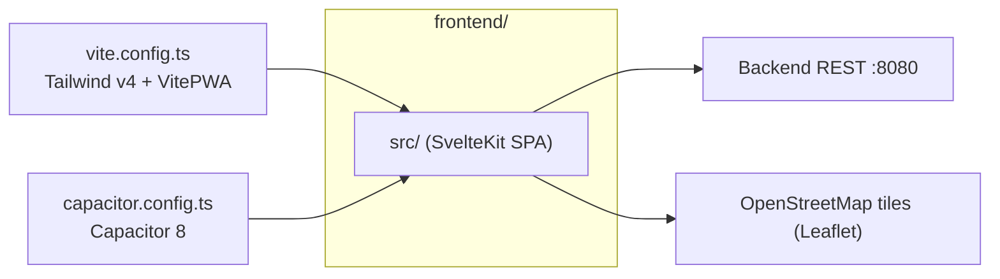
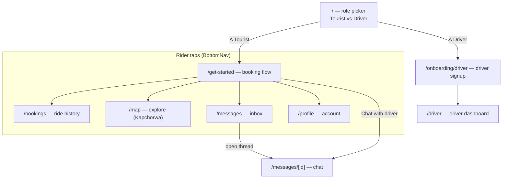
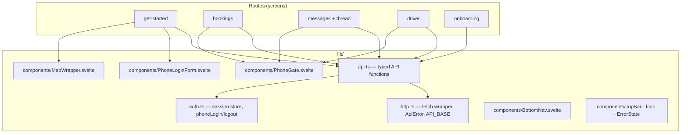
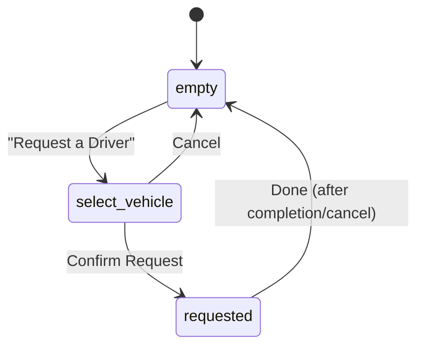
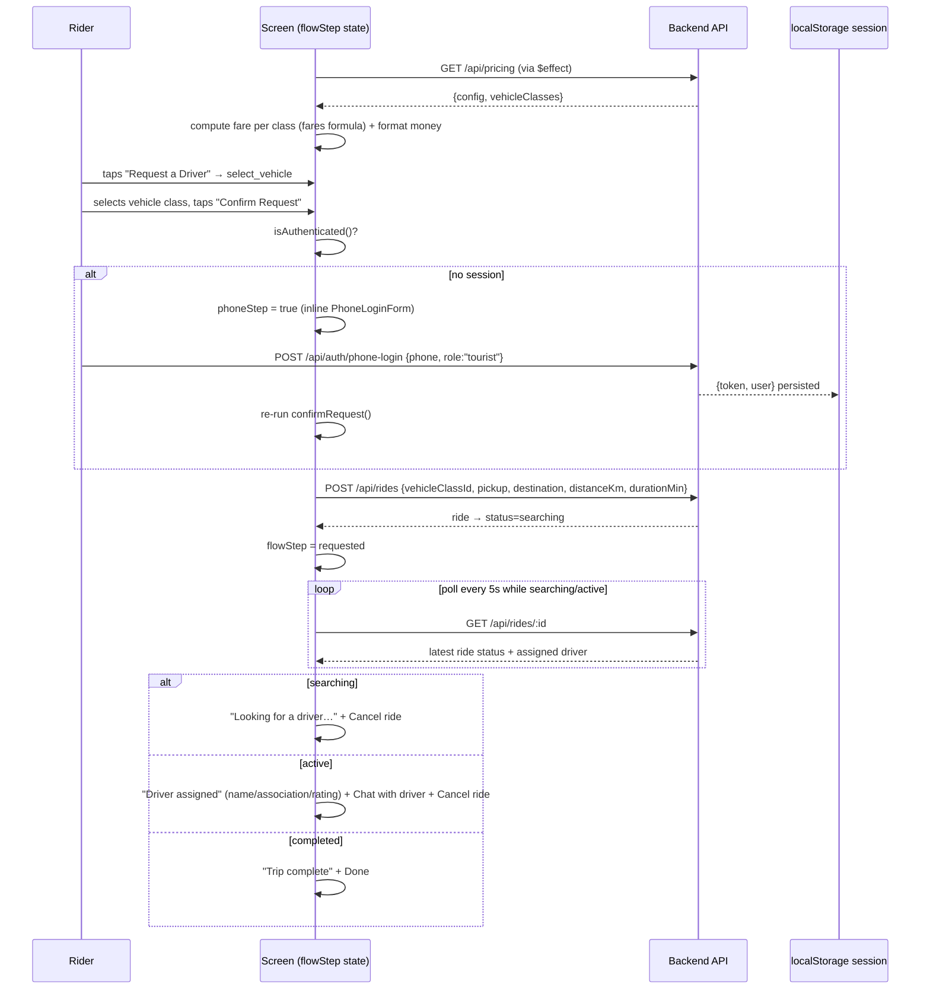
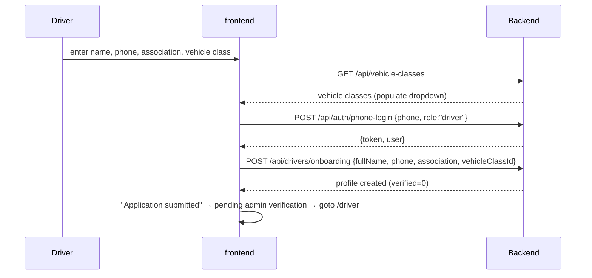
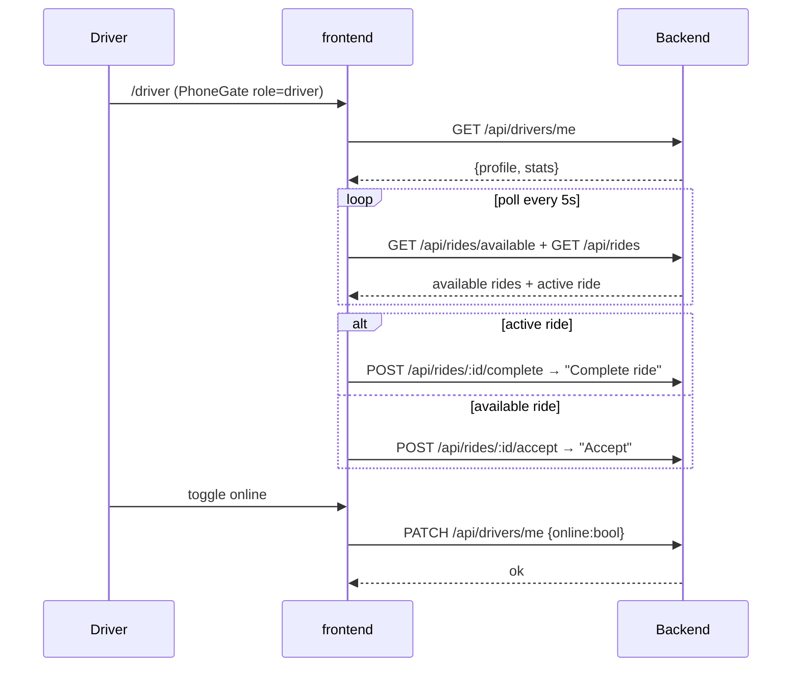

# Frontend — Sipi Rider rider app

The rider-facing mobile app. Package name `sipirider`, in `frontend/`.

- **Framework:** SvelteKit 5 (runes) + Tailwind CSS v4, built as a **static SPA** (`adapter-static`, `fallback: index.html`)
- **Mobile:** Capacitor 8 (native `android/` and `ios/` folders wrap the static build)
- **PWA:** `vite-plugin-pwa` (generateSW + autoUpdate), OpenStreetMap tile runtime caching
- **Maps:** OpenStreetMap raster tiles via `leaflet` (no API key)
- **State:** one Svelte store — `session` (JWT) in `src/lib/auth.ts`
- **API base:** `VITE_API_BASE_URL` (default `http://localhost:8080`)

---

## 1. Screen map

| Route | File | Purpose |
|---|---|---|
| `/` | `src/routes/+page.svelte` | Splash / role picker (Tourist → `/get-started`, Driver → `/onboarding/driver`) |
| `/get-started` | `src/routes/get-started/+page.svelte` | **Main booking flow** (see §3) |
| `/bookings` | `src/routes/bookings/+page.svelte` | Ride history (phone-gated) |
| `/map` | `src/routes/map/+page.svelte` | Static map centered on Kapchorwa District (Sipi Falls) |
| `/messages` | `src/routes/messages/+page.svelte` | Conversation inbox (phone-gated) |
| `/messages/[id]` | `src/routes/messages/[id]/+page.svelte` | Chat thread with send + polling (phone-gated) |
| `/profile` | `src/routes/profile/+page.svelte` | Account info, verification status, profile editing, logout (phone-gated) |
| `/driver` | `src/routes/driver/+page.svelte` | Driver home — online toggle, stats, dispatch board |
| `/onboarding/driver` | `src/routes/onboarding/driver/+page.svelte` | Driver application (name, phone, association, vehicle class) |

There are **no `+page.server.ts`, `+server.ts`, hooks, or load functions** — every screen fetches data in a `$effect` and renders client-side. `PhoneGate` wraps anything that requires a session; the HTTP layer drops an invalid session automatically when a request returns 401, returning the screen to the phone sign-in.

---

## 2. Client architecture

### HTTP layer (`src/lib/http.ts`)

`http<T>(path, {method, body, token})`:

1. Adds `Content-Type: application/json`; adds `Authorization: Bearer <token>` when a token is passed.
2. `fetch(API_BASE + path)`; network failure → `ApiError{status:0, code:'NETWORK_ERROR'}`.
3. Non-OK → parses `{error:{code,message}}` into `ApiError`.
4. A `401` on a request that carried a token clears the session (the token is expired or its account no longer exists), so gated screens fall back to the phone sign-in.
5. `204` → `undefined`; otherwise returns parsed JSON.

### Session store (`src/lib/auth.ts`)

- `session = writable<Session | null>(readSession())`, persisted to `localStorage['sipi_rider_session']`.
- `isAuthenticated()` / `requireToken()` (throws `ApiError` 401 `NO_SESSION` when absent).
- `phoneLogin(phone, role)` → `POST /api/auth/phone-login` (find-or-create; operator verified server-side).
- `logout()` clears store + localStorage.

### API surface used (`src/lib/api.ts`)

| Function | Call | Notes |
|---|---|---|
| `getPricing()` | `GET /api/pricing` | config + vehicle classes |
| `getVehicleClasses()` | `GET /api/vehicle-classes` | vehicle classes for onboarding |
| `createRide(input)` | `POST /api/rides` | bearer |
| `getRides()` | `GET /api/rides` | bearer |
| `getRide(id)` | `GET /api/rides/:id` | bearer — used to poll live ride status |
| `getAvailableRides()` | `GET /api/rides/available` | bearer (driver) |
| `acceptRide(id)` | `POST /api/rides/:id/accept` | bearer (driver) |
| `completeRide(id)` | `POST /api/rides/:id/complete` | bearer (driver) |
| `cancelRide(id)` | `POST /api/rides/:id/cancel` | bearer (rider) |
| `getDriverMe()` | `GET /api/drivers/me` | bearer |
| `setDriverOnline(online)` | `PATCH /api/drivers/me` | bearer |
| `submitDriverOnboarding(input)` | `POST /api/drivers/onboarding` | bearer |
| `getConversations()` | `GET /api/messages` | bearer |
| `getConversationMessages(id)` | `GET /api/messages/:id` | bearer |
| `sendMessage(id, body)` | `POST /api/messages/:id` | bearer |
| `startConversation(recipientId, body)` | `POST /api/messages` | bearer |
| `getProfile()` | `GET /api/profile` | bearer |
| `updateProfile(input)` | `PATCH /api/profile` | bearer |

---

## 3. Booking flow (`/get-started`)

The main booking screen. A client-side state machine drives a full-screen map with floating overlays, and the active ride request is polled until it resolves:

Notes:

- The default route is **hardcoded**: Sheraton Kampala → Entebbe Airport, `41 km / 62 min` (`routeKm`, `routeMin` constants).
- Fares are **computed on-device** from the pricing config (`computeFare`), matching the server formula.
- Booking requires a session; if absent a `PhoneLoginForm` is injected inline and the request retried after success.
- "Chat with driver" starts or reuses a conversation with the assigned driver and navigates to the thread.
- The map (`MapWrapper.svelte`) renders OpenStreetMap tiles with Leaflet, draws a circular marker at Sheraton Kampala, applies the app's teal palette, and shows a graceful fallback if tiles fail to load.

---

## 4. Driver flows

### Onboarding (`/onboarding/driver`)

A single functional application screen — full name, phone, taxi association/SACCO, and a vehicle-class dropdown loaded from `GET /api/vehicle-classes`:

### Driver home (`/driver`)

The dispatch board, polled every 5 seconds while the driver is signed in:

Shows the driver identity card (name, association, verified badge), a stats grid (today earnings, online time, rating), and a map of Kampala. Available ride requests appear only while the driver is online. The screen is reachable via onboarding and via the bottom nav's Home tab.

---

## 5. Styling & theming

- **Tailwind v4** via `@tailwindcss/vite`. Design tokens live in `src/app.css` `@theme`: primary/deep/light teal, `--color-bg`, success, text colors, borders, `--spacing-app: 412px`, font scale, and Inter.
- Custom utilities (`@utility`): `app-frame` (mobile frame, max-width 412px, centered phone on desktop), `field-label`, `field-input`, `btn-primary`, `card`, `chip`, `chip-active`, `no-scrollbar`.
- `tailwind.config.js` is a v3-style config kept in sync with the `@theme` tokens in `app.css`; the `@theme` block is the effective source under Tailwind v4.

---

## 6. PWA & offline

`vite.config.ts` → `VitePWA`:

- `generateSW` / `autoUpdate` / `injectRegister: auto`; manifest name "Sipi Rider — Ride with locals you trust", portrait standalone, teal theme.
- Icons are provided in `static/icons/`: `icon-192.png`, `icon-512.png`, `icon-maskable-512.png`.
- Workbox `runtimeCaching` for `*.tile.openstreetmap.org` uses **NetworkFirst** (`openstreetmap-tiles`, max 200 entries, 7 days) so map tiles stay available offline.

---

## 7. Environment & config files

| File | Notes |
|---|---|
| `vite.config.ts` | Tailwind v4, SvelteKit, VitePWA; dev port `5173`; Workbox tile caching for OpenStreetMap |
| `svelte.config.js` | `adapter-static` → `dist/` with `fallback: index.html` (SPA mode for Capacitor) |
| `capacitor.config.ts` | `appId: 'app.sipirider'`, `appName: 'Sipi Rider'`, `webDir: 'dist'` |
| `.env` | `VITE_API_BASE_URL` (gitignored) |
| `.npmrc` | `engine-strict=true` |

The backend must be reachable at `VITE_API_BASE_URL`; screens show a network error otherwise.
