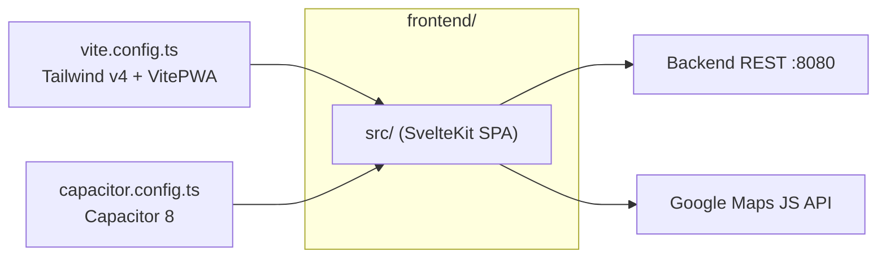
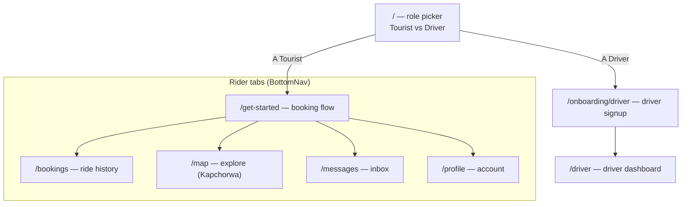
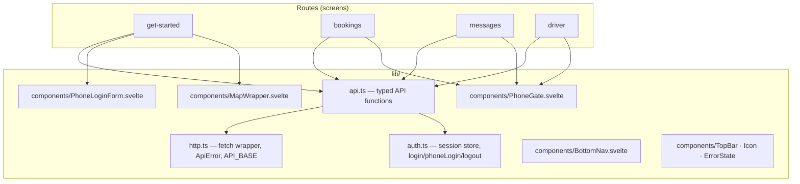
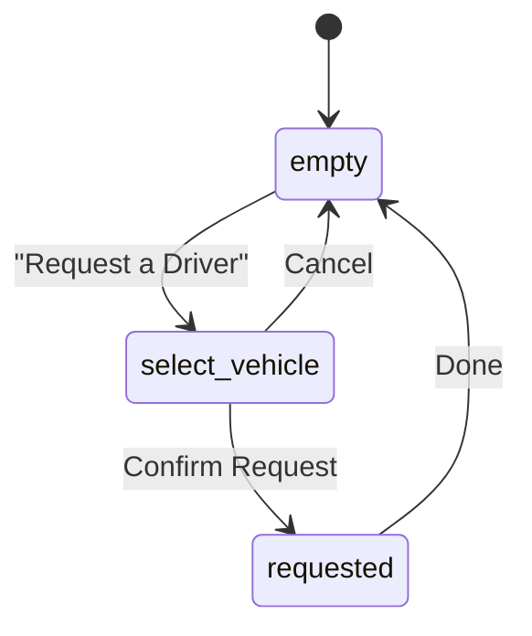
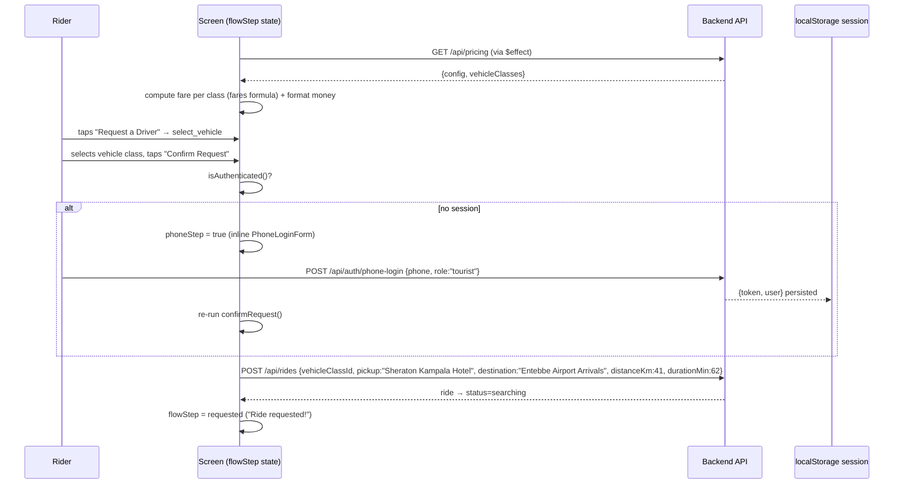
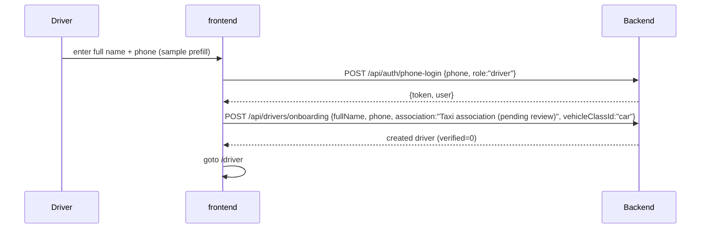
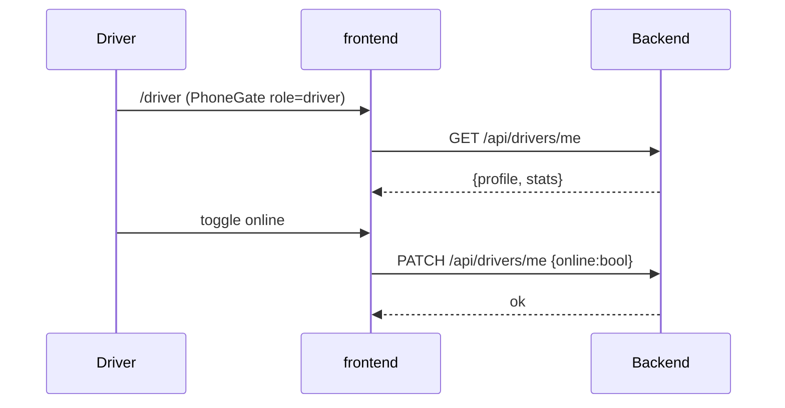

# Frontend — Sipi Rider rider app

The rider-facing mobile app. Package name `sipirider`, in `frontend/`.

- **Framework:** SvelteKit 5 (runes) + Tailwind CSS v4, built as a **static SPA** (`adapter-static`, `fallback: index.html`)
- **Mobile:** Capacitor 8 (native `android/` and `ios/` folders wrap the static build)
- **PWA:** `vite-plugin-pwa` (generateSW + autoUpdate), Google Maps runtime caching
- **Maps:** Google Maps JS API via `@googlemaps/js-api-loader`
- **State:** one Svelte store — `session` (JWT) in `src/lib/auth.ts`
- **API base:** `VITE_API_BASE_URL` (default `http://localhost:8080`)

---

## 1. Screen map

| Route | File | Purpose |
|---|---|---|
| `/` | `src/routes/+page.svelte` | Splash / role picker (Tourist → `/get-started`, Driver → `/onboarding/driver`) |
| `/get-started` | `src/routes/get-started/+page.svelte` | **Main booking flow** (see §3) |
| `/bookings` | `src/routes/bookings/+page.svelte` | My rides (phone-gated) |
| `/map` | `src/routes/map/+page.svelte` | Static map centered on Kapchorwa District (Sipi Falls) |
| `/messages` | `src/routes/messages/+page.svelte` | Conversation inbox (phone-gated) |
| `/profile` | `src/routes/profile/+page.svelte` | Account info + verification status (phone-gated) |
| `/driver` | `src/routes/driver/+page.svelte` | Driver home — online toggle, stats, rating |
| `/onboarding/driver` | `src/routes/onboarding/driver/+page.svelte` | Driver onboarding step 1 (name + phone → phone-login as driver → submit onboarding) |

There are **no `+page.server.ts`, `+server.ts`, hooks, or load functions** — every screen fetches data in a `$effect` and renders client-side. `PhoneGate` wraps anything that requires a session.

---

## 2. Client architecture

### HTTP layer (`src/lib/http.ts`)

`http<T>(path, {method, body, token})`:

1. Adds `Content-Type: application/json`; adds `Authorization: Bearer <token>` when a token is passed.
2. `fetch(API_BASE + path)`; network failure → `ApiError{status:0, code:'NETWORK_ERROR'}`.
3. Non-OK → parses `{error:{code,message}}` into `ApiError`.
4. `204` → `undefined`; otherwise returns parsed JSON.

### Session store (`src/lib/auth.ts`)

- `session = writable<Session | null>(readSession())`, persisted to `localStorage['sipi_rider_session']`.
- `isAuthenticated()` / `requireToken()` (throws `ApiError` 401 `NO_SESSION` when absent).
- `login(email, password)` → `POST /api/auth/login`.
- `phoneLogin(phone, role)` → `POST /api/auth/phone-login` (find-or-create; operator verified server-side).
- `logout()` clears store + localStorage.

### API surface used (`src/lib/api.ts`)

| Function | Call | Notes |
|---|---|---|
| `getPricing()` | `GET /api/pricing` | config + vehicle classes |
| `estimateFare(...)` | `POST /api/rides/estimate` | defined but **unused** — fares computed locally |
| `createRide(input)` | `POST /api/rides` | bearer |
| `getRides()` | `GET /api/rides` | bearer |
| `getDriverMe()` | `GET /api/drivers/me` | bearer |
| `setDriverOnline(online)` | `PATCH /api/drivers/me` | bearer |
| `submitDriverOnboarding(input)` | `POST /api/drivers/onboarding` | bearer |
| `getConversations()` | `GET /api/messages` | bearer |
| `getProfile()` | `GET /api/profile` | bearer |

---

## 3. Booking flow (`/get-started`)

The heart of the rider experience. A three-step client-side state machine driving a map screen with floating overlays:

Notes from review:

- The route is **hardcoded**: Sheraton Kampala → Entebbe Airport, `41 km / 62 min` (`routeKm`, `routeMin` constants).
- Fares are **computed on-device** from the pricing config (`computeFare`) — the `estimateFare` API helper exists but is unused.
- Booking requires a session; if absent a `PhoneLoginForm` is injected inline and the request retried after success.
- The map (`MapWrapper.svelte`) loads Google Maps with a custom teal style, renders an `AdvancedMarkerElement` at Sheraton Kampala, and shows a graceful fallback when no API key is configured.

---

## 4. Driver flows

### Onboarding (`/onboarding/driver`)

The UI advertises a 4-step onboarding but only **step 1** is implemented; association and vehicle class are hardcoded sample values.

### Driver home (`/driver`)

Shows the driver identity card (name, association, verified badge), a stats grid (today earnings, online time, rating), and a map of Kampala. The driver screen is reachable only via onboarding — it is not one of the 5 bottom-nav tabs.

---

## 5. Styling & theming

- **Tailwind v4** via `@tailwindcss/vite`. Design tokens live in `src/app.css` `@theme`: primary/deep/light teal, `--color-bg`, success, text colors, borders, `--spacing-app: 412px`, font scale, and Inter.
- Custom utilities (`@utility`): `app-frame` (mobile frame, max-width 412px, centered phone on desktop), `field-label`, `field-input`, `btn-primary`, `card`, `chip`, `chip-active`.
- `tailwind.config.js` is a **vestigial v3-style** config whose hex values differ slightly from `app.css` (`#149AA0` vs `#14A4A0`, etc.); the `@theme` block is the effective source.
- Minor CSS quirks found: `btn-primary` contains an invalid `items-center: center;` line; `no-scrollbar` is used but never defined.

---

## 6. PWA & offline

`vite.config.ts` → `VitePWA`:

- `generateSW` / `autoUpdate` / `injectRegister: auto`; manifest name "Sipi Rider — Ride with locals you trust", portrait standalone, teal theme.
- Workbox `runtimeCaching` for `maps.googleapis.com` uses **NetworkFirst** (`google-maps-cache`, max 50 entries, 24h) so map assets never go stale offline.
- **Gap found:** the manifest references `/icons/icon-192.png`, `/icons/icon-512.png`, `/icons/icon-maskable-512.png`, but `static/` only contains `robots.txt` — the icons do not exist.

---

## 7. Environment & config files

| File | Notes |
|---|---|
| `vite.config.ts` | Tailwind v4, SvelteKit, VitePWA; dev port `5173`; `ssr.noExternal: ['@googlemaps/js-api-loader']` (CJS named-export fix) |
| `svelte.config.js` | `adapter-static` → `dist/` with `fallback: index.html` (SPA mode for Capacitor) |
| `capacitor.config.ts` | `appId: 'com.example.myapp'`, `appName: 'MyApp'`, `webDir: 'dist'` — **still default placeholders** |
| `.env` | `VITE_GOOGLE_MAPS_API_KEY` |
| `.npmrc` | `engine-strict=true` |

### Known gaps from the review

1. **API contract:** this app targets the Express backend (`rides`, `phone-login`, `pricing`, `messages`). If the backend is not running on `:8080`, every screen shows `NETWORK_ERROR`.
2. **PWA icons missing** from `static/`.
3. **Capacitor app ids/names** still placeholder (`com.example.myapp` / `MyApp`).
4. Onboarding is 1 of 4 planned steps; sample/hardcoded values used.
5. `estimateFare` API helper unused; `BottomNav` on `/driver` has no bound `activeTab`.
